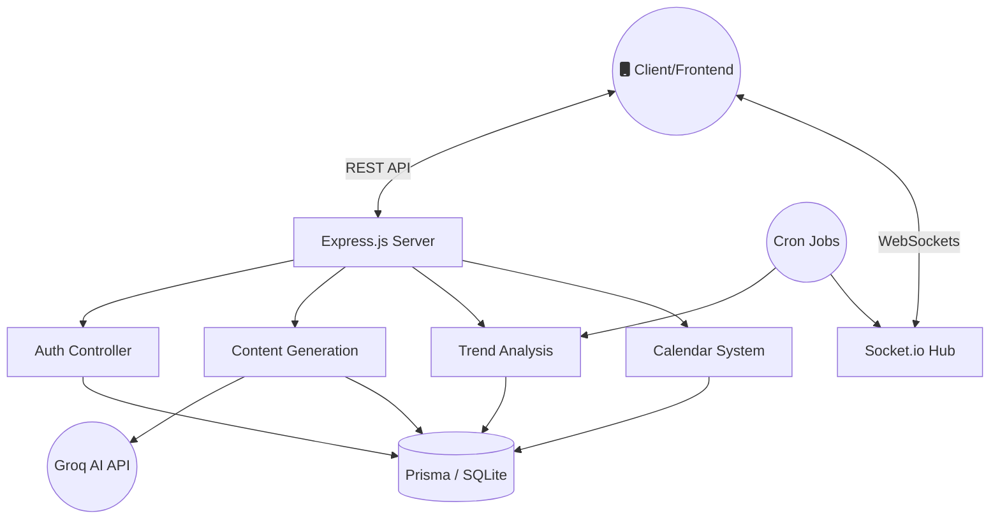

<div align="center">


<br/>

[](https://nodejs.org/)
[](https://expressjs.com/)
[](https://www.prisma.io/)
[](https://socket.io/)
[](https://vercel.com/)

</div>

---

## 🌟 Overview

The **ViralIQ Backend** is a highly scalable, real-time API engine designed to power the ViralIQ platform. It seamlessly integrates advanced AI content generation, real-time WebSocket communication, and robust database management to deliver a next-generation marketing experience.

<div align="center">
  
</div>

## ✨ Core Features

| Feature | Description | Tech Stack |
|---------|-------------|------------|
| 🔐 **Authentication** | Secure JWT-based auth with Google OAuth integration | `jsonwebtoken`, `bcryptjs`, `@react-oauth/google` |
| 🧠 **AI Engine** | Lightning-fast AI generation using Groq API | `groq-sdk`, `zod` |
| 📡 **Real-Time Data** | Live trend tracking and push notifications | `socket.io` |
| 🗄️ **Database** | Type-safe ORM with automated migrations | `Prisma` (SQLite/PostgreSQL) |
| ⏱️ **Cron Jobs** | Automated background tasks for trend refreshing | `node-cron` |

---

## 🏗️ Architecture



---

## 📂 Project Structure

```text
backend/
├── 📁 prisma/           # Database schema & migrations
├── 📁 src/
│   ├── 📁 controllers/  # Request handlers (Auth, Content, Trends, etc.)
│   ├── 📁 middleware/   # Custom middlewares (Auth Guard, Error Handler)
│   ├── 📁 routes/       # Express route definitions
│   ├── 📁 services/     # Third-party integrations (Groq, Jobs, Claude)
│   ├── 📄 index.js      # Application entry point
│   └── 📄 setup.js      # Vercel environment initializer
├── 📄 package.json      # Dependencies & scripts
└── 📄 vercel.json       # Serverless deployment configuration
```

---

## 🚀 Quick Start

### 1. Prerequisites
- Node.js `v18+`
- npm or yarn

### 2. Environment Setup
Create a `.env` file in the root of the backend directory:
```env
PORT=3001
DATABASE_URL="file:./dev.db"
JWT_SECRET="your_super_secret_key"
JWT_EXPIRES_IN="7d"

# Google OAuth
GOOGLE_CLIENT_ID="your_google_client_id"

# AI Integrations
GROQ_API_KEY="gsk_..."
```

### 3. Installation & Run
```bash
# Install dependencies
npm install

# Generate Prisma Client & Migrate Database
npx prisma generate
npx prisma migrate dev

# Start development server (with Nodemon)
npm run dev
```

---

## 📡 API Endpoints Summary

### 🔐 Authentication (`/api/auth`)
- `POST /register` - Register a new user
- `POST /login` - Login with email & password
- `POST /google-login` - Login with Google OAuth
- `GET /me` - Get current authenticated user

### 📝 Content (`/api/content`)
- `POST /generate` - Generate viral content using Groq AI
- `GET /history` - Fetch user's content history

### 📈 Trends (`/api/trends`)
- `GET /` - Fetch live trending hashtags and topics (Supports WebSocket subscriptions)

### 📅 Calendar (`/api/calendar`)
- `GET /` - Fetch scheduled posts
- `POST /` - Schedule new content

---

## ☁️ Deployment (Vercel)

This backend is fully optimized for **Vercel Serverless Functions**.

1. Connect your GitHub repository to Vercel.
2. The `vercel.json` file is pre-configured to build and route requests correctly.
3. Added a dynamic `setup.js` script that ensures SQLite compatibility within the Vercel read-only Lambda environment by mapping it to `/tmp`.

> **Note for Production**: For persistent data, switch the Prisma provider to `postgresql` and link a Vercel Postgres database!

---

<div align="center">
  
### Made with ❤️ for ViralIQ


</div>
